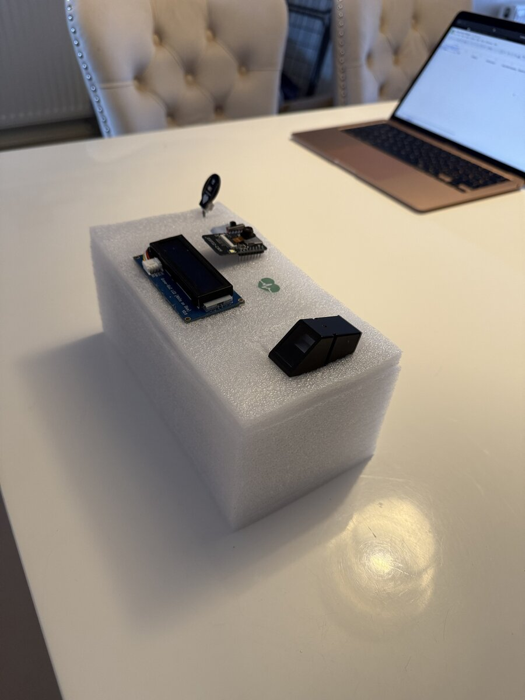
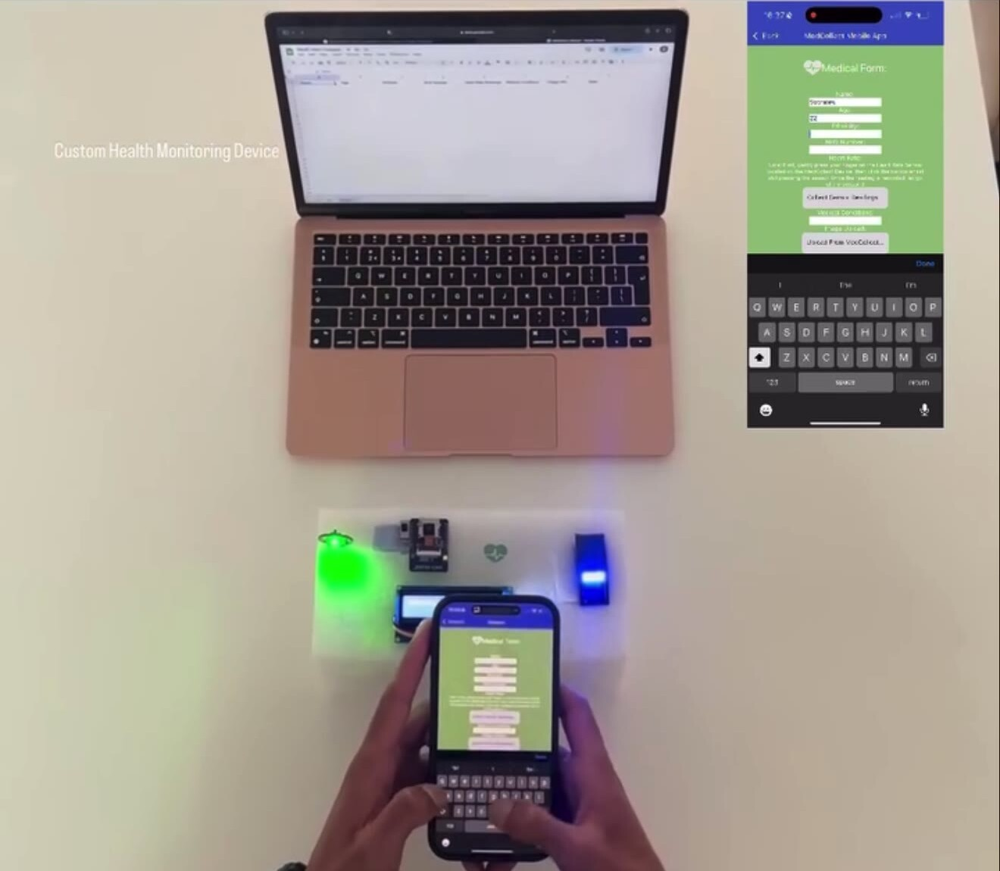

# MedCollect

A portable IoT prototype for capturing patient data. A fingerprint sensor secures access, a pulse sensor takes readings, and a companion mobile app triggers measurements over Wi-Fi and uploads each record to the cloud.

Showcased at the Innovation Fest at Birmingham City University.

| The device | Live demo |
|---|---|
|  |  |

## How it works

1. **Authentication (Arduino Uno R3):** reads the fingerprint sensor and reports `ACCESS_GRANTED` to the main board over serial.
2. **Main board (Arduino Uno R4 WiFi):**
   - shows status messages on a Grove RGB LCD
   - reads the pulse sensor on `A0`
   - runs a small HTTP server on port 80
3. **Companion app:** connects to the device's IP address, triggers readings, combines them with patient details and a photo, and uploads each record to a Google Sheets dataset.

The companion app was built with a no-code app builder for the demo. This repository contains the device firmware I wrote.

## HTTP endpoints (Uno R4 WiFi)

| Endpoint | What it does |
|---|---|
| `GET /updateStatus` | Returns the latest device status, e.g. after authentication |
| `GET /sayHi` | Test call: shows a message on the LCD |
| `GET /collectData` | Takes a pulse reading and returns the raw sensor value |
| `GET /closeApp` | Shows a disconnected message on the LCD |

The pulse value is the raw averaged analogue reading (0–1023), not calibrated beats per minute.

## Hardware

- Arduino Uno R4 WiFi (main board)
- Arduino Uno R3 (fingerprint authentication)
- Optical fingerprint sensor (Adafruit Fingerprint library, SoftwareSerial on pins 2/3 of the R3)
- Pulse sensor (A0 on the R4)
- Grove RGB LCD 16×2 (I²C)
- ESP32-CAM camera module
- Serial link between the boards; R4 pin 7 resets the R3 on start-up

## Firmware

```
firmware/
  r3_fingerprint/   fingerprint authentication (Uno R3)
  r4_main/          Wi-Fi, LCD, pulse sensor and HTTP server (Uno R4 WiFi)
```

To build `r4_main`, copy `arduino_secrets.example.h` to `arduino_secrets.h` and add your Wi-Fi details. That file is git-ignored, so credentials are never committed.

Libraries: `WiFiS3`, `Wire`, `rgb_lcd` (Grove LCD RGB Backlight), `Adafruit_Fingerprint`, `SoftwareSerial`.
